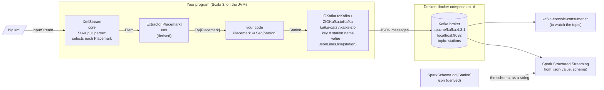
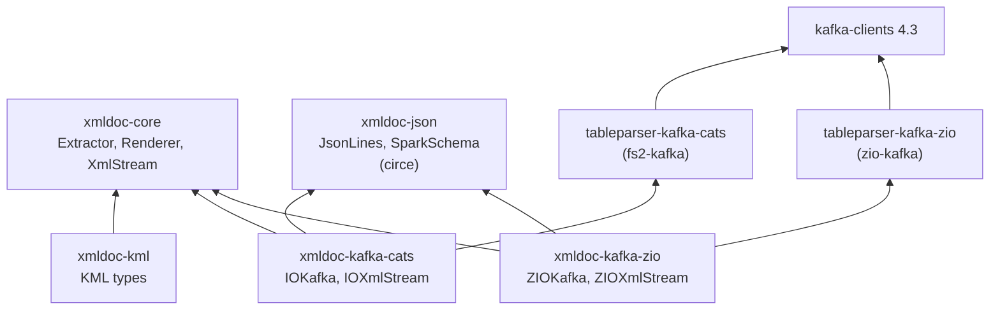

# From KML to Kafka (and Spark)

This is a walk-through of the whole pipeline: a (possibly huge) KML file is read as a stream, each `Placemark` is extracted
as soon as it has been read, turned into plain records, and each record is sent to a Kafka topic as one JSON message,
which a Spark job can read with a schema derived from the same record type.
The Kafka broker runs in Docker (`docker-compose.yml`, in the root of this repository).

## The architecture

Each box names the XmlDoc module (or library) which does that step.
However big the file, the memory used is bounded: the selected elements (here, Placemarks) are read a chunk (64) at a
time, and the Kafka producer buffers what it hasn't yet sent (up to its `buffer.memory`, 32 MB by default).
Each selected element is built whole, though, so choose a selector (like `Placemark`) whose elements are small.



The libraries underneath:



## 1. Start the broker

You need Docker with its Compose plugin: Docker Desktop, or (on a Mac) `brew install colima docker docker-compose` and then `colima start`.
From the root of the repository:

```bash
docker compose up -d
```

If Docker Desktop was once installed and has since been replaced (by Colima, say), two leftovers can get in the way:
`docker compose` is "unknown" (the plugin in `~/.docker/cli-plugins` is a link into the old app: link it to Homebrew's
`docker-compose` instead), or the image can't be pulled because `docker-credential-desktop` isn't found
(delete the line `"credsStore": "desktop",` from `~/.docker/config.json`).

`docker ps` shows the `xmldoc-kafka` container as `healthy` once the broker is ready (after ten seconds or so).
The broker listens on `localhost:9092`. Topics are created when they're first written to, but you can create one explicitly:

```bash
docker exec xmldoc-kafka /opt/kafka/bin/kafka-topics.sh --bootstrap-server localhost:9092 --create --topic stations
```

The heart of `docker-compose.yml` is a single node which is both broker and controller (KRaft mode, so no ZooKeeper):

```yaml
services:
  kafka:
    image: apache/kafka:4.3.1
    ports:
      - "9092:9092"
    environment:
      KAFKA_PROCESS_ROLES: broker,controller
      KAFKA_LISTENERS: PLAINTEXT://:9092,CONTROLLER://:9093
      KAFKA_ADVERTISED_LISTENERS: PLAINTEXT://localhost:9092
      # ... (one replica for each internal topic, since there's only one broker)
```

## 2. Define the records

A record is a plain case class: it's what goes to Kafka (as JSON) and what Spark reads (with the derived schema).
`Placemark` itself can't be a record (it has a second parameter list), so build records from the values you need:

```scala
import com.phasmidsoftware.xmldoc.json.SparkSchema
import io.circe.Encoder

case class Point(lon: Double, lat: Double) derives Encoder.AsObject, SparkSchema
case class Station(name: String, point: Point, elevation: Option[Double]) derives Encoder.AsObject, SparkSchema

// One Station for each coordinate of each Point of a Placemark.
def stationsOf(p: Placemark): Seq[Station] = for {
  case point: com.phasmidsoftware.xmldoc.kml.Point <- p.Geometry
  cs <- point.coordinates
  c <- cs.coordinates
} yield Station(p.name.$.toString, Point(c.long.toDouble, c.lat.toDouble), c.maybeAlt.map(_.toDouble))
```

## 3. Stream the file to Kafka

With fs2 (`xmldoc-kafka-cats`):

```scala
import cats.effect.IO
import com.phasmidsoftware.xmldoc.kafka.cats.{IOKafka, IOXmlStream}
import fs2.Stream
import fs2.kafka.ProducerSettings
import scala.util.Success

val settings = ProducerSettings[IO, String, String].withBootstrapServers("localhost:9092")

val sent: IO[Long] =
  IOXmlStream.extractFile[Placemark]("big.kml", "Placemark") // Stream[IO, Try[Placemark]], read as the file is read
    .collect { case Success(p) => p }                          // (or log the failures)
    .flatMap(p => Stream.emits(stationsOf(p)))                 // Stream[IO, Station]
    .through(IOKafka.toKafka("stations", settings)(_.name))    // one JSON message per Station, keyed by its name
    .compile.count
```

Or with ZIO (`xmldoc-kafka-zio`):

```scala
import com.phasmidsoftware.xmldoc.kafka.zio.{ZIOKafka, ZIOXmlStream}
import zio.ZLayer
import zio.kafka.producer.{Producer, ProducerSettings}
import zio.kafka.serde.Serde
import zio.stream.ZStream
import scala.util.Success

val producer = ZLayer.scoped(Producer.make(ProducerSettings(List("localhost:9092"))))

val sent = ZIOXmlStream.extractFile[Placemark]("big.kml", "Placemark")
  .collect { case Success(p) => p }
  .flatMap(p => ZStream.fromIterable(stationsOf(p)))
  .via(ZIOKafka.toKafka("stations", Serde.string)(_.name))
  .runCount
  .provideLayer(producer)
```

The fs2 version, ready to run, is `kafka-it/src/test/scala/.../kafkait/StationsToKafka.scala`.
With the broker running, from the root of the repository:

```bash
sbt "kafkaIt/Test/runMain com.phasmidsoftware.xmldoc.kafkait.sendStations"
```

It sends the four Points of `kml/src/test/resources/KML_Samples.kml`; give it another KML file (and, optionally, other bootstrap servers) as arguments:

```bash
sbt "kafkaIt/Test/runMain com.phasmidsoftware.xmldoc.kafkait.sendStations path/to/your.kml localhost:9092"
```

## 4. Watch the topic

```bash
docker exec xmldoc-kafka /opt/kafka/bin/kafka-console-consumer.sh --bootstrap-server localhost:9092 --topic stations --from-beginning --formatter-property print.key=true
```

Each message is a key (the station's name) and one line of JSON:

```text
Simple placemark	{"name":"Simple placemark","point":{"lon":-122.0822035425683,"lat":37.42228990140251},"elevation":0.0}
```

## 5. Read the topic with Spark

Spark (Scala 2.13, or PySpark) parses each message with the schema which `SparkSchema` derives from the record type,
so the producer and the consumer can't disagree about the JSON:

```scala
SparkSchema.ddl[Station]
// `name` STRING, `point` STRUCT<`lon`: DOUBLE, `lat`: DOUBLE>, `elevation` DOUBLE
```

```scala
// In the Spark job: paste the schema string in.
val schema = "`name` STRING, `point` STRUCT<`lon`: DOUBLE, `lat`: DOUBLE>, `elevation` DOUBLE"
val stations = spark.readStream.format("kafka")
  .option("kafka.bootstrap.servers", "localhost:9092")
  .option("subscribe", "stations")
  .option("startingOffsets", "earliest")
  .load()
  .select(from_json(col("value").cast("string"), schema, Map.empty[String, String]).as("station"))
  .select("station.*")
```

## 6. Stop the broker

```bash
docker compose down
```

The topics (and their messages) go with the container.

## Without Docker

The integration tests (`sbt kafkaIt/test`) start a broker inside the JVM instead (embedded-kafka), and run the same
pipeline (`StationsToKafka.send`) against it.
