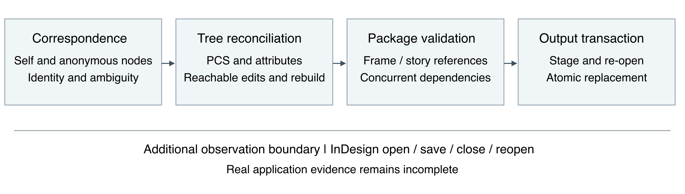
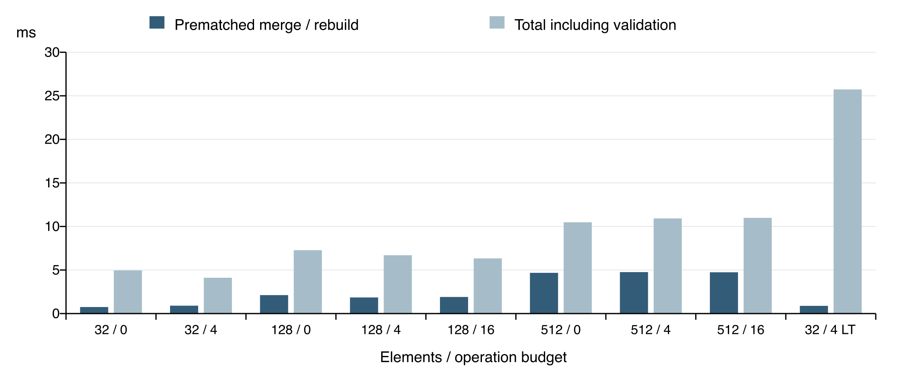

# Three Way Merging of IDML Documents through Structural Reconciliation and Layered Validation

## Abstract

Collaborative editing of publishing documents requires reconciling changes to content, object order, layout structure, and references distributed across files. A successful merge of individual XML trees does not by itself establish that the resulting document package is consistent or that writing it is safe. This paper presents an implementation and empirical case study of three-way merging for Adobe InDesign Markup Language (IDML), developed within the XmlDoc project. Building on Lindholm's parent–child–sibling relation model, the system combines node correspondence, structural reconciliation, attribute-level refinement, strict deletion-versus-edit checking, package-level reference validation, and atomic output replacement. The research progressed from experiments on object identifier stability to a reusable XML core and a versioned validation program. Its findings include identity-related edit loss, obsolete structural relations, formatting-node mismatches, and two corrections to the test oracle itself. A deterministic corpus contains 16 scenarios, evaluated in both branch orders against complete results or conflict reports. Archived validation records show 946 passing Scala tests and 22 passing Python tests, with one pre-existing ignored Scala test reported separately. A calibrated benchmark contains 125 formal measurements across 25 generated scenarios; the maximum prematched merge/rebuild time was 7.280 ms and the maximum measured pipeline time was 26.960 ms. These measurements cover generated trees and minimal packages. Four planned real-world acceptance cases remain unsupplied, and InDesign opening, saving, and reopening have not been validated. The study therefore supports bounded implementation claims and a layered account of correctness, rather than a claim of production readiness or a new general correctness theorem.

**Keywords:** three-way merge; XML; IDML; node correspondence; structural conflict; reproducible validation

## 1 Introduction

Independent changes to a common document create a familiar reconciliation problem: which changes can be combined, and which require a human decision? For publishing documents, the answer depends on more than textual overlap. One editor may change a frame's appearance while another moves it. A paragraph may move with its containing section. Two independently inserted objects may receive the same identifier. Deleting a frame may also affect a story stored in another XML part. These operations expose different failure modes even when every individual input file is syntactically valid.

IDML is a useful setting for studying this problem because it represents an InDesign document through XML components and a package structure [2]. In the project examined here, spreads, stories, master spreads, and resources are discovered through a design map. Objects carry attributes such as `Self`, `ParentStory`, and `NextTextFrame`; their relationships combine ordered trees with references between trees. This makes the gap between a structurally valid merge and an application-valid document observable.

The project began with an IDML-specific question: could object identifiers provide sufficiently stable correspondence to combine independent edits? It subsequently adopted a generic relation-based merge core, exercised that core on KML, and added package validation and transactional writing. A later verification program revisited both the implementation and the expected outcomes used to test it. The resulting research record is valuable because several conclusions changed as the scope of observation expanded from one object, to a complete tree, to a complete package.

This paper addresses four questions:

- **RQ1:** What correspondence assumptions are supported by the available IDML observations, and how should unidentified or ambiguous nodes be handled?
- **RQ2:** How can structural and content changes be combined while detecting incompatible edits and preventing silent loss from the final reachable tree?
- **RQ3:** Which additional checks are needed when a tree merge becomes an IDML package operation and a Git merge driver?
- **RQ4:** What do the current functional and performance experiments establish, and which claims still require application-level evidence?

The contribution is an engineering case study with an implemented separation of concerns, a traceable account of defects and oracle revisions, and a reproducible validation package. The PCS representation is inherited from prior work [1]. Attribute refinement, strict policy selection, domain checks, and file-writing guarantees are identified explicitly as project decisions. We do not claim to have disproved the underlying XML merge model, replicated the complete original 3dm implementation, or established superiority over competing tools.

## 2 Background and related work

### 2.1 Three-way merging and the XML representation

A three-way merge receives a common ancestor and two independently modified versions. The ancestor distinguishes a new edit from a value merely retained by one branch. Treating all branch values as equally new requirements creates false conflicts; treating one branch as authoritative can erase the other's work.

Lindholm's XML merge targets human-authored documents modeled as ordered trees and supplies the conceptual foundation for this project [1]. The project adopts its separation between node content and relative position, together with conflict reasoning over relations. Accurate correspondence is a precondition to that reasoning. The tests in this study therefore assess matching separately from reconciliation, rather than assuming that a successful relation computation establishes correct object identity.

The implementation uses `GenericElement` and separate text and CDATA nodes. Equality is defined by the supported representation: child order and text whitespace matter; attribute ordering does not. This is not a claim of full XML Infoset equivalence. In particular, the model does not provide general expanded-name normalization for namespace prefixes, and unsupported processing instructions require special treatment at package boundaries.

### 2.2 Document-specific merging

Document-aware tools provide a complementary precedent. The nbdime project interprets notebook structure and generated fields rather than treating the notebook serialization as arbitrary lines [3]. Its relevance here is architectural: domain knowledge can determine useful merge units and policies. IDML requires different domain rules, including frame–story relationships and package integrity; this study does not evaluate nbdime on IDML or compare their performance.

Git's custom merge-driver interface provides the integration mechanism [4]. A driver receives ancestor, current, and other versions through substituted file paths and writes its result to the current-version path. The interface enables a structural merger but does not establish whether its candidate document is valid or whether a failed write preserves the original file. Those obligations must be implemented and tested by the driver.

## 3 Research design and development history

### 3.1 Evidence and study boundaries

The study combines repository research notes, implementation history, deterministic fixtures, automated tests, and archived benchmark data [5–9]. The research sequence extends from the first package support in August 2026 to the structured validation program in November 2026. Historical observations are retained as observations of particular files and sessions, not promoted into universal properties of InDesign.

Three evidence classes are kept separate. First, manually exported examples support exploratory observations about identifiers, metadata, and document evolution. Second, generated fixtures encode specific operations with independent expected outcomes. Third, application acceptance requires authorized real triples and an InDesign record of opening, saving, closing, and reopening. The existence of the first class does not imply completion of the third.

The functional results reported in Section 6 refer to implementation checkpoint `f2bca0a`. The performance measurements refer to checkpoint `9696666`. Both checkpoints used Scala 3.8.4 and sbt 1.11.7. Later repository revisions include compiler and integration changes; the archived performance data are not presented as measurements of those later revisions. Source locations and reproduction commands are given in Appendix B.

### 3.2 Establishing the identifier assumption

Early inspection distinguished autogenerated object identifiers, identifiers derived from a parent and component position, and predefined resource names. These forms cannot all be interpreted as equivalent evidence of persistent identity. The primary structural experiments concerned autogenerated `Self` identifiers on document objects.

In the small `HelloWorld2` examples, an object retained its identifier when moved or restyled. An initial observation that independent insertions received different identifiers was later contradicted by the `Mergeable` trio: two independently created rectangles received the same `Self`, `u11c`, but differed in content. The revised design therefore treats insertion collisions as a genuine possibility. It does not infer that matching identifiers alone prove a shared editing history for newly created objects.

An apparent wholesale shift of existing identifiers also required correction. The affected examples originated from a continuing in-memory editing session; a fresh close-and-reopen protocol produced a cleaner correspondence with the saved base. A separate export-before-save and export-after-save comparison preserved all observed identifiers while changing XMP bookkeeping. These observations ruled out a simple claim that saving alone necessarily regenerates identity, but did not establish the precise cause of the earlier drift.

The larger `Magazine` examples exposed a further boundary. The original file reported DOMVersion 8.0, while two edited variants reported 21.5. One variant largely retained correspondence; the other had a disjoint story-identifier space. The research consequently restricted its intended merge inputs to independent edits from the same saved base and the same InDesign version. Cross-version recovery remains outside the supported experimental scope. Same-version use is a scope restriction, not a mathematical guarantee of stable identity.

### 3.3 From attributes to reusable structure

The first IDML merge prototype compared matched objects and reconciled attributes. This supported independent changes such as movement attributes on one side and fill or stroke changes on the other. It could not observe a pure reorder of siblings when node attributes remained unchanged.

The PCS representation, edit detector, reconciler, and tree builder were added in September. The structural layer was then separated into `core`, and `ThreeWayMerger` combined it with the finer attribute merger. Testing a whole spread exposed volatile `LinkImportTime` changes that object-focused checks had missed. Testing a whole package exposed `StyleUniqueId` volatility and a genuine story-text conflict. Increasing the unit of observation thus discovered both false positives and conflicts that earlier checks had never examined.

Applying the generic layer to KML revealed two additional weaknesses: text was initially omitted from the relation representation, and positional correspondence could silently lose an edit after a sibling deletion. Leaf-text preservation and a content matcher addressed the motivating examples. A subsequent October revision represented text and CDATA as ordered nodes in their own right, including mixed content. Later tests showed that this richer representation also required more careful character-node identity.

### 3.4 Verification as a separate research phase

The November MR01–MR14 program froze policy and test contracts before evaluating the integrated implementation. It separated matching, PCS encoding, reconciliation, reconstruction, and package behavior, then added corpus execution, generated properties, benchmarks, and public-entry acceptance tests.

This phase revised expected behavior as well as code. Case 10 had incorrectly treated an unchanged parent on one side as a competing move. It was changed to a successful merge without altering its original inputs, and a new case 10b introduced two genuinely different new parents. The text policy was also fixed to `strict-text-node-v1`: different concurrent values of the same text node conflict even when the corresponding word edits are disjoint. These changes were recorded as policy clarification and oracle correction, not concealed as implementation improvements.

## 4 Method

### 4.1 Ordered relations and edit sets

Let O be the ancestor and L and R the two branches after correspondence has assigned consistent node identities. A PCS tuple records a parent and two adjacent members of its ordered child list. Start and end sentinels make the first and last positions explicit. Let P(T) contain these structural tuples and C(T) contain node-content relations. The encoded state is

$$T^{*}=P(T)\cup C(T).\tag{1}$$

The implementation computes new relations relative to the ancestor:

$$E_L=T_L^{*}\setminus T_O^{*},\qquad E_R=T_R^{*}\setminus T_O^{*}.\tag{2}$$

For an ordinary set comparison, the initial reconciliation universe can be written as

$$D=T_O^{*}\cup E_L\cup E_R=T_O^{*}\cup T_L^{*}\cup T_R^{*}.\tag{3}$$

This identity explains why the ancestor plus branch differences can supply the required relations. It does not mean that taking a union completes the merge. Contradictions still need reconciliation, obsolete ancestor links must be removed, and the remaining structure must be validated. Ignored-attribute comparison adds a project-specific semantic equality policy; tests of the literal set identity and relation provenance are therefore separated from tests of that policy.

`PcsMerger` reconciles content, successor, predecessor, and parent requirements. An unmodified slot retains its ancestor value; a one-sided edit takes precedence over the old value; equal concurrent edits agree; incompatible new requirements produce a conflict. A conflict report carries its slot and ancestor/left/right values. The implementation does not choose a branch or invent an intermediate value for a genuine conflict.

### 4.2 Correspondence before reconciliation

Nodes with `Self` use that identity within the declared validation scope. Duplicate identities in an input part are rejected rather than silently overwritten by a map construction. The package validator additionally maintains separate frame and story identity indexes. It does not impose an unexamined universal uniqueness rule across every kind of resource.

Unidentified elements are matched within corresponding contexts. Exact subtree equality supplies anchors; remaining candidates use the matcher's restricted fallback. The implementation explicitly rejects some ambiguous duplicate-content count changes. Unmatched descendants are included in the unmatched partition, and newly inserted anonymous descendants are scoped to their nearest identified ancestor so that independent inserts do not accidentally share a raw path identity.

These measures improve the supported cases but do not solve arbitrary XML matching. Equal content can arise from different histories, document-order fallback can remain ambiguous, and unidentified cross-parent movement is not generally recognized. The system's correspondence contract must therefore remain narrower than a claim to recover every true editing history.

Character data requires separate care. Elements, text, and CDATA participate in the ordered representation, preserving their type, payload, and relative order. For strictly alternating indentation and element lists, formatting nodes can be anchored to the following matched element or the end boundary. The IDML entry point also assigns positions to consecutive character nodes within such contexts. Text-only parents retain the existing text-slot convention. This avoids the demonstrated ordinal-shift failure without trimming body text or discarding whitespace, but is not a general solution for all changes to mixed-content segmentation.

### 4.3 Combining structural and attribute decisions

The generic content relation treats a node's represented content atomically. The IDML layer refines this for identified elements: independent edits to distinct attributes may be combined. `ThreeWayMerger` takes structure from the PCS layer and applicable attribute outcomes from `Merger`, replacing coarser duplicate content reports where the attribute merger has handled the identified node.

The distinction also changes what constitutes a valid provenance assertion. At the atomic PCS level, an output content value should be traceable to the input relations under the tested policy. At the attribute-refined level, a new complete attribute map may legitimately combine a fill value from one branch with a stroke value from the other. Its provenance must be checked attribute by attribute, rather than rejected because the complete map never appeared unchanged in an input.

Two volatile attributes are ignored for change detection by default: `LinkImportTime` and `StyleUniqueId`. Ignoring them does not remove them from output. Existing matched nodes retain ancestor values for those fields; a new node retains values from its source. When both branches introduce the same identity with equivalent significant content, a canonical UTF-8 ordering selects one complete source attribute collection. This deterministic rule avoids left/right-dependent field mixtures. Unchanged package entries follow a different preservation contract: their extracted bytes remain those of ours.

### 4.4 Reachability and strict deletion checks

Relations retained in an intermediate set need not all be reachable from the output root. Consequently, preserving an edit relation is not sufficient if the containing subtree disappears. Let Δ denote the reconciled relation set and let the encoded final reachable tree be Tm*. Under the project's strict deletion policy, the relevant preservation condition is

$$(\Delta\setminus T_m^{*})\cap(E_L\cup E_R)=\varnothing.\tag{4}$$

This expresses the relation-level distinction between edits that survive reconciliation and edits actually represented in the reachable result; attribute-refined outputs require the corresponding attribute-level preservation check. The project's strict checking follows the optional deleted-region concern documented in its theoretical basis [1, 6]; it is not presented as a newly discovered omission from that basis.

`deletedSubtreeConflicts` uses the same prematched input relations as the merge. It inspects changes in ancestor regions that become unreachable, including deep text edits and inserted children. A descendant moved out of a deleted group and retained in the candidate must not be rejected merely because its old ancestor vanished. Conversely, a text update left only in disconnected relations cannot count as successfully preserved.

Reconstruction is a separate gate. The builder rejects unresolved conflicts and malformed relation structures, including missing content, ambiguous links, cycles, and incompatible parent requirements. Cleanup removes unused old ancestor links; it must not remove an untraversed new edit simply to make reconstruction succeed.

### 4.5 Package validity and concurrent dependencies

The package layer reconciles declared XML parts and constructs a logical candidate before writing. Static validation covers the supported references: `TextFrame.ParentStory`, `NextTextFrame`, and `PreviousTextFrame`. Nonempty links must resolve; thread edges must be reciprocal and remain within a story; next-frame chains must be acyclic. Missing, empty, and `n` values have explicitly tested endpoint meanings for the thread fields. The supported reference vocabulary is a whitelist, not a claim to validate every IDML reference or external resource URI.

A second check concerns concurrent intent. A branch that deletes a frame or changes its story/thread topology alters layout dependencies. If the other branch edits the body of a related story, the package merger reports a conservative domain conflict. The affected story set includes relevant old and new memberships and edge endpoints. The rule is symmetric and includes negative controls for unrelated stories, one-sided operations, and changes confined to ignored metadata.

Static reference validity and concurrent dependency checks answer different questions. A candidate may have legal references while combining edits whose story-level intentions require review. The dependency rule does not infer which characters would flow into a particular frame after layout, and it may reject combinations that a layout-aware resolver could eventually accept.

### 4.6 Output transaction

The driver writes a candidate to a staging copy in the same directory as the destination, completes part updates and design-map reference patches, reopens and validates the staged package, then atomically replaces ours. If atomic replacement is unavailable, the operation fails without a destructive fallback. Conflict and returned I/O-failure paths preserve the original destination and clean up staging artifacts.

The design map is not fully three-way merged. Its content is retained from ours except for targeted changes to part references, preserving processing instructions and other unmodeled material. Likewise, retention of untouched entry bytes does not imply identical ZIP container bytes or symmetric archive metadata. The established guarantee concerns returned failures and tested output integrity; it does not establish power-loss durability or concurrent writes to the same destination.



*Figure 1. The implemented pipeline separates identity, tree reconciliation, package semantics, and file replacement. InDesign application acceptance is an additional, currently incomplete observation boundary.*

## 5 Evaluation design

### 5.1 Versioned scenarios and independent oracles

The deterministic corpus contains 16 cases under schema version 3 and `strict-text-node-v1` [7]. Inputs derive from the XML of an existing small IDML fixture. They model the specified operations directly and are not represented as independently exported GUI artifacts. Every case contains ancestor/left/right inputs, provenance and hashes, and an executable expected-result contract.

Successful cases declare a complete entry inventory and expected XML snapshots. Conflict cases specify complete business conflict objects, adapted to the implementation's report slots without invoking the merger to construct the expectation. Verification is read-only; regeneration is an explicit separate command. Unknown profiles, old schemas, corrupt hashes, incomplete inventories, and inconsistent statuses are rejected.

Table 1 summarizes the frozen scenarios. The eight successful and eight conflicting outcomes describe the fixture inventory, not the observed probability that an arbitrary editing session will merge successfully.

*Table 1. Deterministic corpus and frozen expectations.*

| Case | Concurrent operation or condition | Expected result |
|---|---|---|
| 01 | One-sided insertion | Accept |
| 02 | One-sided deletion | Accept |
| 03 | One-sided sibling movement | Accept |
| 04 | Insertions at different anchors | Accept |
| 05 | Incompatible movements of one node | Conflict |
| 06 | Deletion versus attribute modification | Conflict |
| 06b | Frame deletion versus related story edit | Domain conflict |
| 07 | Edits to different paragraphs in one story | Accept |
| 08 | Overlapping changes to one text node | Conflict |
| 08b | Disjoint word changes within one text node | Conflict |
| 09 | Equivalent resulting z-order changes | Accept |
| 10 | Ungrouping plus an independent transform update | Accept |
| 10b | Two different new parents for one node | Conflict |
| 11 | One-sided insertion into a reciprocal thread | Accept |
| 12 | Different next-frame attribute values | Conflict |
| 13 | Story reassignment versus related story edit | Domain conflict |

Each case is exercised in normal and swapped branch order. The corpus suite checks complete tree/package outcomes and conflict multisets; the package/driver suite independently checks writing and reopening the corresponding permutations. The two sets of 32 executions are overlapping evaluations of 16 underlying scenarios, not 64 independent scenarios. The simple deletion case does not by itself establish arbitrary thread repair; reference behavior is evaluated through the dedicated thread and package cases.

### 5.2 Layer tests and generated properties

The test program separates five layers: correspondence, PCS representation and detection, reconciliation, reconstruction, and package behavior. Assertions inspect full XML structure and complete conflict objects, rather than only the presence of one modified attribute or a nonzero conflict count.

Generated tests check identity cases, swapping of branches, preservation of supported edits, and provenance within declared generation models. They also include fixed counterexamples so that a generator's constraints cannot remove an important regression. Atomic relation properties and attribute-refinement properties use different assertions. These finite tests are empirical evidence about their generated domains, not proofs for all XML trees.

Negative tests deliberately construct duplicate identities, damaged packages, invalid references, malformed relation sets, and injected write failures. Public-entry tests verify the CLI distinction between success, conflict, and failure, along with preservation of input hashes and cleanup of temporary files. This makes failure behavior part of correctness rather than a secondary operational concern.

### 5.3 Performance protocol

The benchmark uses generated trees with stable identities at sizes of 32, 128, and 512 elements; seeds 13, 37, and 73; and operation budgets of 0, 4, and, for the two larger sizes, 16. A separate 32-element case assigns 64 KiB of text per leaf. These choices yield 24 bounded-text scenarios and one long-text scenario.

Insert, delete, move, and update operations are sampled with equal proposal probability. Independent subtree and sibling contexts are enforced by rejecting invalid or reused proposals. The resulting operation distribution is recorded rather than assumed to remain balanced. Operation budget and the number of detected relation edits are different quantities.

Calibration uses one warmup and two measured repetitions. Formal measurement uses three warmups and five measured repetitions per scenario. Limits were frozen before formal measurement: 250 ms total, 100 ms prematched merge/rebuild, 960 MiB sampled JVM heap, and a per-scenario median merge time no more than four times calibration, with a 1 ms denominator floor.

The recorded environment is macOS on aarch64, 10 reported processors, Java 21.0.12.1, and a 1 GiB configured JVM heap. Parsing, matching, prematched relation reconciliation/reconstruction, package writing, and total time are recorded separately. Every measurement validates a complete independent target and reopens the written minimal ZIP. Total time includes these checks and is not simply the sum of the four displayed stages. Heap sampling is JVM-wide, not operation allocation or operating-system RSS.

## 6 Results

### 6.1 Functional validation

The archived clean run at `f2bca0a` reports 432 passing core tests, 404 IDML tests, and 110 KML tests, totaling 946 Scala tests [8]. One existing `ExtractorsSpec.extractor3B` test was ignored and is reported separately. The Python validation and corruption tests report 22 passes. The six public-entry acceptance tests are included in the IDML total and must not be added again.

The schema-3 corpus verification reports all 16 cases and confirms that verification did not change fixture bytes or modification times. Both branch orders are exercised against the frozen oracle. These results support conformance for the tested policies and scenarios. They do not establish a field conflict rate, universal absence of false negatives, or complete IDML format coverage.

### 6.2 What the failures revealed

**Correspondence can fail silently.** In the motivating A/B/C example, deleting A shifts the paths of B and C. A path-based matcher can then misattribute the other branch's edit to C while returning no conflict. Exact content anchors and restricted fallback correct the demonstrated case. Duplicate `Self` rejection closes a different failure mode in which a map silently overwrites an input node. Both findings concern the matching precondition, not an algebraic contradiction in PCS reconciliation.

**A retained ancestor relationship is not a new edit.** The initial parent-conflict logic inferred new requirements from nodes mentioned in edit relations. A sibling reorder can mention a node while leaving its parent unchanged. The corrected logic computes parent mappings from complete matched states and compares each with the ancestor. It accepts a parent move combined with internal edits when compatible, while still rejecting two different newly chosen parents.

**A reconstructable path is not a validated relation set.** Moving a node could leave an unused ancestor link in the relation collection. A traversal might ignore that residual and still build an apparently correct tree. Complete relation assertions motivated explicit cleanup and stricter reconstruction checks. This distinguished intentional removal of obsolete ancestor information from accidental removal of a new edit.

**Whitespace identity matters when whitespace is preserved.** The full-package version of case 04 exposed false conflicts from character-node ordinals that shifted after independent insertions. Anonymous descendants beneath newly inserted objects created a related identity collision. The fix strengthened identity contexts and retained whitespace payloads. The tests did not obtain success by trimming documents.

**Strict deletion checking must inspect the final reachable result.** Attribute-only deletion checks missed deep text changes and insertions. The revised check covers modified or inserted content within deleted regions, including regression depths of 1, 4, and 12, while retaining the counterexample in which a child moves to a reachable location before its old group disappears. The meaningful outcome is preservation in the document, not merely retention in an intermediate set.

**An oracle can encode a mistaken interpretation.** Case 10 originally required a conflict even though only one branch changed the parent. Its revised expected result preserves both the move and the other branch's `ItemTransform` value. Case 10b now supplies the actual two-parent contradiction. Separately, 08b remains a conflict because text nodes are atomic under the chosen profile. These revisions show why changing an expectation requires an independent semantic justification and a recorded migration.

**Tree validity does not settle package intent.** Cases 06b and 13 require story-level domain reasoning across parts. Candidate reference checks detect dangling or inconsistent links, while concurrent dependency checks detect a different class of potentially incompatible intentions. The two checks cannot substitute for each other, and neither establishes final page geometry.

**A correct candidate still needs a safe commit operation.** Failure injection demonstrated the need to avoid sequential destructive writes to ours. The staged transaction covers part updates, design-map patching, reopen validation, and final replacement. The driver preserves the original on the tested conflict and returned-failure paths, including a failure injected at final replacement.

### 6.3 Performance observations

All 125 formal measurements validated their independent target and passed the frozen limits [9]. Across the full matrix, the maximum prematched merge/rebuild time was 7.280 ms; the maximum total time was 26.960 ms. The sampled heap peak was 744.816 MiB, while the recorded aggregate memory-pool peak was 745.816 MiB. Neither heap measure should be interpreted as the memory required for a single small tree.

Table 2 is recomputed from the archived raw repetitions. For bounded-text rows, three seeds are pooled within each size/budget group, giving 15 observations. The stress row contains five observations. The p95 uses the nearest-rank convention; with these small groups it equals the observed maximum and is not a reliable tail-latency estimate for deployment.

*Table 2. Descriptive timings from the formal benchmark in milliseconds.*

| Elements | Edit budget | Observations | Merge median / p95 | Total median / p95 |
|---|---|---|---|---|
| 32 | 0 | 15 | 0.750 / 2.808 | 4.950 / 10.893 |
| 32 | 4 | 15 | 0.905 / 1.568 | 4.112 / 6.579 |
| 128 | 0 | 15 | 2.119 / 2.845 | 7.276 / 8.473 |
| 128 | 4 | 15 | 1.849 / 2.332 | 6.697 / 8.415 |
| 128 | 16 | 15 | 1.905 / 2.802 | 6.334 / 18.207 |
| 512 | 0 | 15 | 4.676 / 6.259 | 10.481 / 14.263 |
| 512 | 4 | 15 | 4.760 / 7.280 | 10.923 / 13.610 |
| 512 | 16 | 15 | 4.740 / 5.229 | 10.987 / 13.939 |
| 32 with long text | 4 | 5 | 0.886 / 1.002 | 25.733 / 26.960 |



*Figure 2. Median prematched merge/rebuild and total times for the Table 2 groups. Labels show element count and operation budget; LT denotes the 64 KiB-per-leaf case. Groups pool repeated measurements of fixed seeds, not independently sampled production documents.*

The long-text case has a low merge/rebuild median but the largest total median, showing why a structural-core measurement must be separated from the surrounding workflow. The data do not support treating total time as the complexity of relation reconciliation alone.

The archived least-squares fit over 120 bounded-text observations uses node count and detected relation edits. It reports an intercept of 0.9421 ms, a node coefficient of 0.007653 ms, an edit coefficient of −0.001893 ms, R² of approximately 0.889, and residual RMSE of 0.562 ms. The negative edit coefficient prevents a monotone causal interpretation of edit cost. This limited matrix does not establish an asymptotic bound, and passing calibration thresholds does not establish production latency guarantees. No head-to-head baseline or optimization ablation was measured.

### 6.4 Application acceptance remains incomplete

The real-world manifest reserves four cases: text editing with movement, ungrouping with style changes, thread deletion versus story editing, and thread/resource preservation. At the recorded acceptance checkpoint, zero of four cases were supplied and `releaseReady` was false. The strict gate exited with failure while reporting a valid manifest contract.

The archived remote run at `84343cb` similarly recorded successful automated regressions and a failed release-evidence job [8]. This is a dated observation of that run, not a statement about the current status of the moving branch. The failure reflects missing real evidence rather than a passing InDesign test being counted as skipped. No supplied record demonstrates that the merged documents open, save, close, and reopen correctly in InDesign or preserve intended visual layout.

## 7 Discussion

### 7.1 Four distinct correctness boundaries

The study supports a layered interpretation of correctness. The first boundary is **identity**: the correspondence must associate the right objects. The second is **tree reconciliation**: the selected policy must produce consistent relations and preserve relevant edits in the reachable output. The third is **package semantics**: the collection of trees must satisfy supported references and concurrent dependencies. The fourth is **delivery and observation**: serialization and replacement must preserve the candidate, and the consuming application must exhibit the intended result.

Success at one boundary does not establish the next. A good reconciler can faithfully combine wrongly matched nodes. Well-formed XML can contain dangling frame references. A valid candidate can be damaged by a partial write. An intact package can still produce an unintended layout. The present implementation provides automated evidence at the first three boundaries and at the file-transaction portion of the fourth. The application-observation portion remains open.

### 7.2 Policy should be part of the reproducible result

The meaning of a conflict depends on the chosen editing unit. Two word replacements can be independent under a token-level model and incompatible under an atomic text-node model. Similarly, a strict deletion policy and a permissive policy answer different product requirements. Tests cannot accept either outcome interchangeably while claiming to validate one policy.

Versioning the schema and profile makes those decisions reviewable. It also distinguishes a legitimate semantic revision from weakening an oracle to accommodate existing output. The correction to case 10 is particularly instructive: preserving its input bytes and introducing a separate genuine counterexample retained evidence of both compatible behavior and actual structural conflict.

### 7.3 Generality without erasing domain assumptions

The core's use in KML demonstrates architectural reuse and exposes weaknesses that a predominantly attribute-oriented IDML prototype had hidden. It does not establish arbitrary XML support. Unidentified correspondence, text segmentation, namespace representation, and unsupported infoset components remain explicit limits.

Conversely, IDML-specific rules should not be disguised as universal tree constraints. A story-level dependency conflict is a conservative domain judgment. Preserving an `ItemTransform` string is a data-level outcome, not a coordinate transformation or visual equivalence proof. Maintaining this separation allows improvements to matching, layout awareness, and domain coverage without attributing them to a new PCS theorem.

## 8 Threats to validity and remaining work

**Construct validity.** XML equivalence and complete conflict objects are stronger than isolated attribute assertions, but neither directly measures user-visible layout or editorial intent. The strict text profile deliberately excludes token-level merging. The reference whitelist also excludes several resource relationships; passing validation therefore means passing the declared subset.

**Internal validity.** The same project developed implementation and fixtures, creating a risk of shared assumptions. Independent expected snapshots, immutable input hashes, oracle migrations, fixed counterexamples, and read-only verification reduce this risk but do not remove it. Reported test totals include multiple assertions of related behaviors and cannot be treated as independent experimental samples.

**External validity.** The deterministic corpus is small and generated. Historical exports are exploratory examples rather than a representative sample of real collaborative workflows. The four planned application cases remain absent. Same-version scope, unknown session effects, identifier collisions, and the absence of repeated multi-round editing studies limit generalization.

**Performance validity.** The benchmark measures at most 512 elements in its main matrix, uses selected nonoverlapping operation contexts, and runs on one recorded machine and JVM configuration. It does not measure the full driver on realistic publications, unidentified matching worst cases, deep chains, high fan-out, many simultaneous deletions, or cold-start deployment. The coarse and shared heap measurements further limit memory conclusions.

**Implementation scope.** The current matcher does not universally recover unidentified movement or distinguish equal-content histories. Character-node identity remains sensitive to logical segmentation. The generic representation lacks some XML fidelity guarantees, and design-map content is not fully reconciled. Atomic replacement does not prove crash durability or support simultaneous operations on the same output path.

The immediate empirical priority is to supply the four authorized same-version triples with recorded operations, independent expectations, and InDesign open/save/reopen evidence. Subsequent studies should add broader document sampling, conflict precision and missed-edit measurements, baseline comparisons, and ablations that isolate matching, strict deletion checks, and domain validation. Performance work should extend the shape and content distributions before changing algorithms on the basis of the current small matrix.

## 9 Conclusion

The project developed an IDML three-way merger by combining a reusable structural XML core with attribute policies, explicit correspondence handling, strict checks on deleted regions, package-level validation, and atomic writing. Its research history shows why each layer needed its own evidence: broader tests uncovered failures invisible at the preceding layer, and revisiting the theoretical contract corrected both implementation defects and mistaken expected outcomes.

The available record establishes passing automated validation for a frozen 16-case corpus and the associated regression suites, together with 125 successful formal measurements on generated workloads. It does not establish complete IDML semantics, universal XML correspondence, comparative performance, or production readiness. The principal result is an implemented and traceable route from structural reconciliation to safer document-package handling, with the remaining application-level validation clearly separated from completed automation.

## References

[1] Tancred Lindholm. 2004. A three-way merge for XML documents. In *Proceedings of the 2004 ACM Symposium on Document Engineering*, 1–10. [https://doi.org/10.1145/1030397.1030399](https://doi.org/10.1145/1030397.1030399).

[2] Adobe Systems Incorporated. 2012. *IDML File Format Specification*, Version 8.0. Adobe-authored specification, archived copy. [Specification PDF](https://raw.githubusercontent.com/jorisros/IDMLlib/master/docs/idml-specification.pdf).

[3] Project Jupyter. *nbdime documentation*. [Content-aware notebook diffing and merging](https://nbdime.readthedocs.io/en/latest/). Accessed 12 November 2026.

[4] Git Project. *gitattributes documentation*. [Defining a custom merge driver](https://git-scm.com/docs/gitattributes#_defining_a_custom_merge_driver). Accessed 12 November 2026.

[5] XmlDoc project. 2026. *Notes toward a 3-way merge for IDML* and *The generic merge layer*. Research records at revision `aa698b2`. [IDML research log](https://github.com/rchillyard/XmlDoc/blob/aa698b2/idml/MERGE.md); [core research log](https://github.com/rchillyard/XmlDoc/blob/aa698b2/core/MERGE.md). Historical entries describe the state at their respective dates.

[6] XmlDoc project. 2026. *IDML XML Merge Test Specification*. Frozen policy and validation contracts. [Specification at aa698b2](https://github.com/rchillyard/XmlDoc/blob/aa698b2/idml/docs/xml-merge-test-spec.md).

[7] XmlDoc project. 2026. *Reliable Three-Way IDML Merge Corpus*. Schema 3, profile `strict-text-node-v1`. [Corpus and oracle documentation](https://github.com/rchillyard/XmlDoc/tree/aa698b2/idml/src/test/resources/com/phasmidsoftware/xmldoc/idml/three-way-corpus).

[8] XmlDoc project. 2026. *MR14 acceptance evidence*. Local implementation checkpoint `f2bca0a`; archived remote observation `84343cb`. [Evidence record](https://github.com/rchillyard/XmlDoc/blob/aa698b2/idml/docs/xml-merge-test-evidence.md); [machine-readable validation](https://github.com/rchillyard/XmlDoc/blob/aa698b2/idml/docs/evidence/mr14-validation.json).

[9] XmlDoc project. 2026. *MR13 XML merge performance*. Formal measurements at `9696666`. [Protocol and results](https://github.com/rchillyard/XmlDoc/blob/aa698b2/idml/docs/xml-merge-performance.md); [raw formal measurements](https://github.com/rchillyard/XmlDoc/blob/aa698b2/idml/docs/evidence/mr13-formal.json).

## Appendix A Research chronology and implementation trace

The chronology distinguishes the introduction of a capability from its later validation. Commit identifiers locate research milestones; they are not intended as a list of separate experiments or independent replications.

*Table A1. Main research milestones.*

| Period | Milestone | Representative evidence |
|---|---|---|
| August 2026 | Package discovery, story representation, initial identifier experiments | `9151908`, `0d0cb82`, `dab2579` |
| August 2026 | Same-version scope, matching and attribute merger, insertion collision correction | `91ee757`, `374f1ce`, `b1c4596`, `5eb49a4` |
| September 2026 | PCS representation, edit detection, reconciliation and reconstruction | `a47c1d9`, `843e7de`, `e9e1e52`, `3bfc202` |
| September 2026 | Unique-parent check, combined tree merger, reusable core and driver | `c83173f`, `63737cc`, `7a7a8fb`, `087834b` |
| September to October 2026 | KML-driven text/matching corrections and full character-node representation | `10d4976`, `a57e395`, `d7ac69e` |
| November 2026 | Frozen contracts, 16-case oracle, layer tests and implementation corrections | MR01–MR12; specification and corpus |
| November 2026 | Calibration, formal measurements, acceptance tests and explicit evidence gate | `9696666`, `163d4b9`, `f2bca0a`, `84343cb` |

*Table A2. Validation program mapped to research responsibilities.*

| Work item | Responsibility |
|---|---|
| MR01 | Freeze scope, policy, interfaces, and completion criteria |
| MR02 | Complete XML and conflict assertion helpers |
| MR03 | Versioned corpus, hashes, oracle migration, and read-only verification |
| MR04 | Stable correspondence, unidentified nodes, and duplicate identity rejection |
| MR05 | PCS encoding and edit detection |
| MR06 | Compatible structural and content changes |
| MR07 | Contextual conflicts, genuine parent changes, and strict deleted-region checks |
| MR08 | Mixed content and rejection of invalid reconstruction |
| MR09 | All corpus cases in both branch orders |
| MR10 | Generated identity, symmetry, preservation, and provenance properties |
| MR11 | Candidate reference validity and story-level concurrent dependencies |
| MR12 | Complete package preservation and atomic output behavior |
| MR13 | Stage timings, calibration, frozen limits, and formal measurements |
| MR14 | Public-entry automation and a separate real-world acceptance gate |

## Appendix B Reproduction and interpretation

The functional checkpoint is `f2bca0ae7695fe58d353915dc729d8dec49b463a`; the benchmark checkpoint is `969666658930d34a5bb743781ab7ad0735dcaf3e`. Reproduction requires each revision's build and recorded environment. Table 2 and Figure 2 aggregate archived measurements; no new timing experiment is claimed.

The functional record used these commands:

```bash
sbt 'core/clean' 'idml/clean' 'kml/clean' \
  'core/test' 'idml/test' 'kml/test'
python3 -m unittest discover -s idml/tools -p 'test_*.py'
python3 idml/tools/generate_three_way_corpus.py --verify
```

Invoke `com.phasmidsoftware.xmldoc.idml.MergeBenchmark` through `idml/Test/runMain` with an output JSON path and either `calibration` or `formal`. The raw JSON records source and gate digests, environment, repetitions, operations, rejected proposals, relation edits, and correctness flags. New environments require separate calibration without replacing the historical baseline.

The application gate is `idml/tools/verify_real_world_manifest.py`. Its optional pending-data mode validates planning structure only. Completed acceptance requires four supplied cases and their application evidence.

